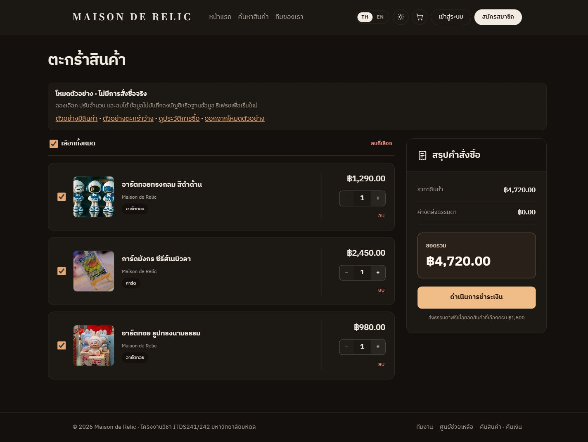
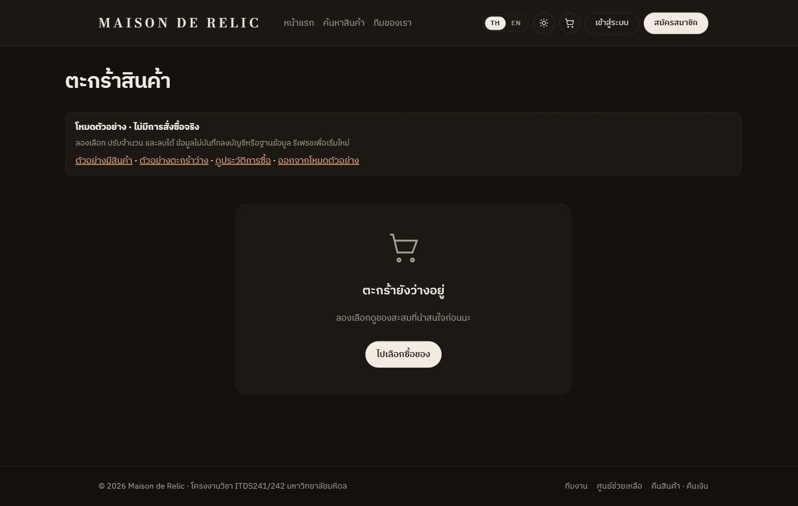
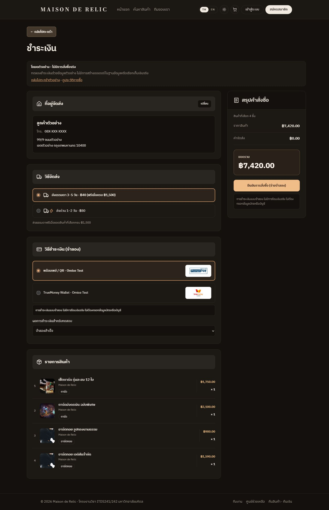
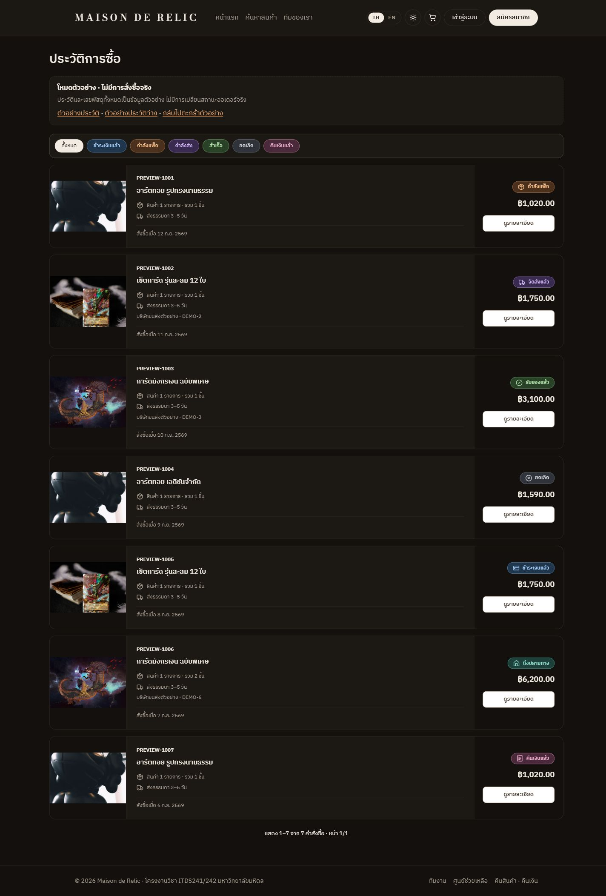
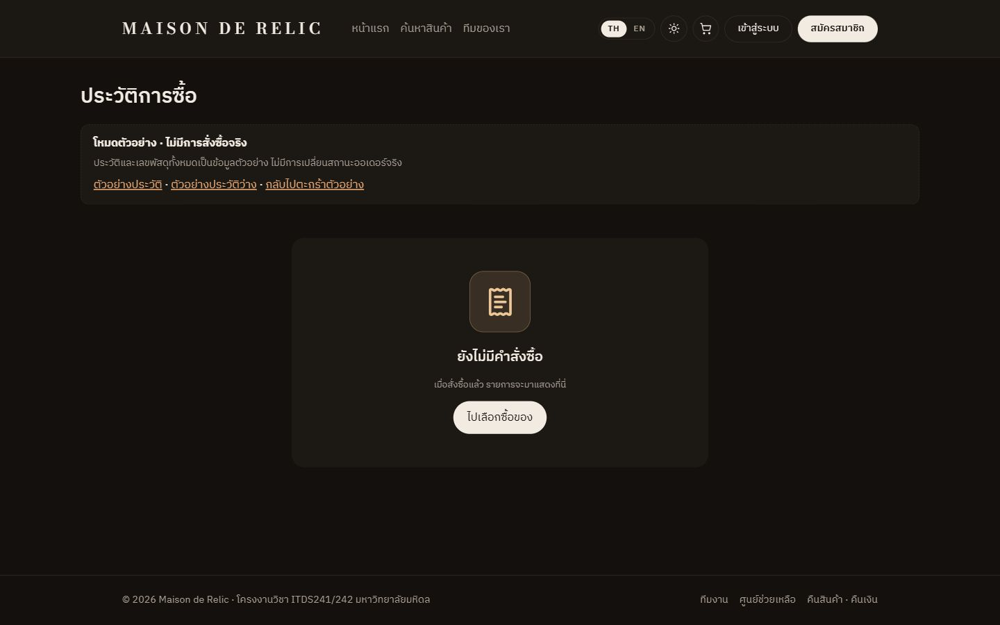
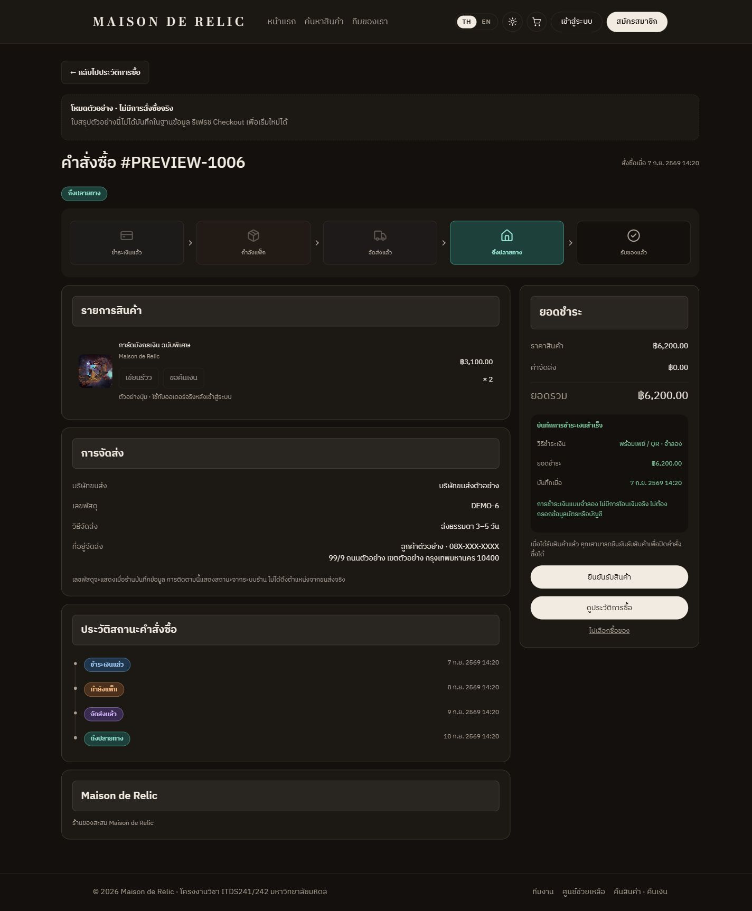
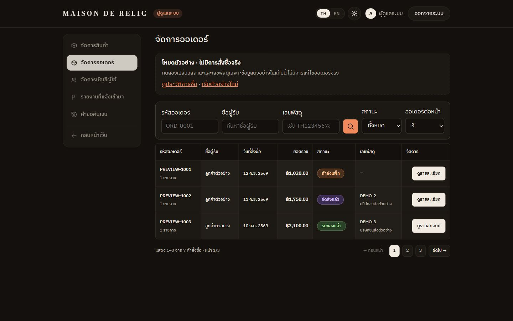
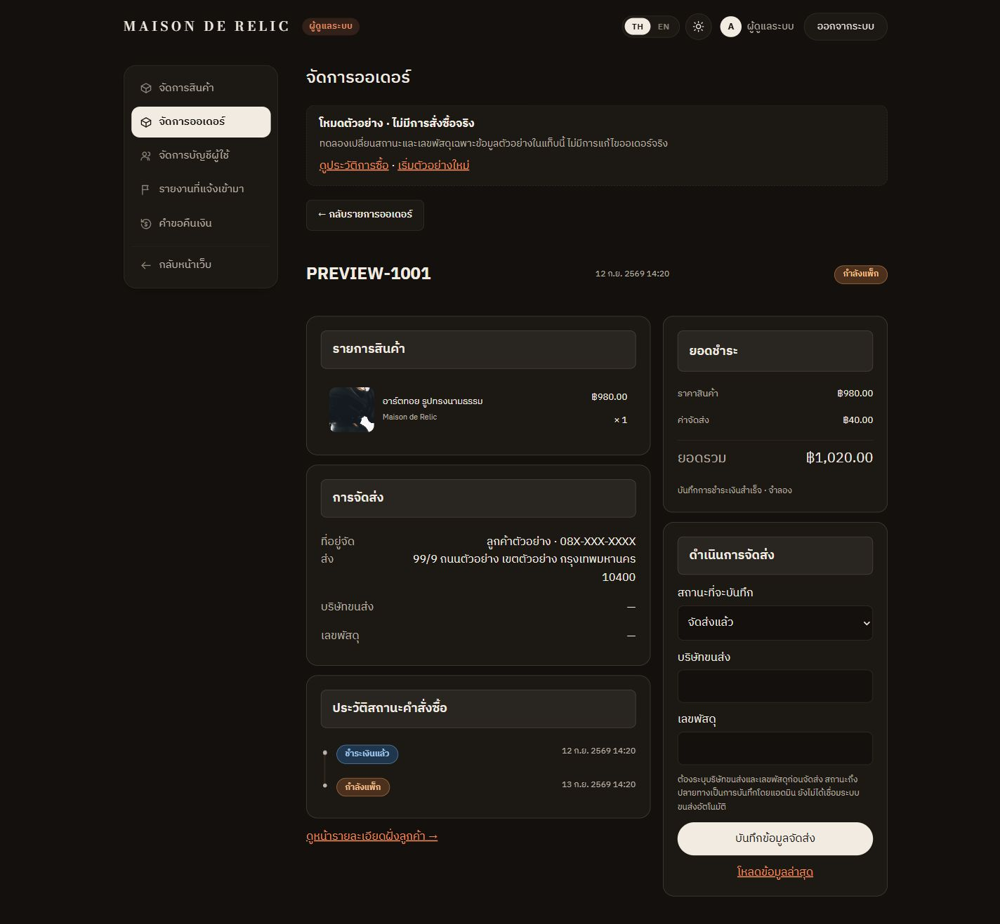

# Maison de Relic

Maison de Relic is a collectibles storefront built as a five-person project for **ITDS241/242 at Mahidol University**. Customers can discover products, place orders, track deliveries, and access after-sales services. The frontend uses HTML, CSS, and vanilla JavaScript; the API uses Node.js 24 and Express with PostgreSQL 16. Docker Compose runs the services locally.


*The homepage was developed by R4. It is shown here to introduce the shared project before the R5 feature walkthrough.*

Explore the [team architecture](docs/architecture.png), [API documentation](docs/api.md), and [wireframe guide](docs/wireframe.md).

For the online, browser-only portfolio demo, use the [Vercel demo guide](docs/portfolio/vercel-deploy.md). Cart, simulated payment, and orders persist in each visitor's browser, without a hosted API or database.

## Team credits

This is a collaborative project. This README focuses on the **R5 features I owned** and identifies the systems built by my teammates that those features use.

| Role | Contributor | Main responsibilities |
|---|---|---|
| R1 · Tech Lead / After-sales | [Phakawat (Peem)](https://github.com/PhakawatL) | Project foundation, Team page, Wishlist, Reviews, Refunds, Support |
| R2 · Identity / Admin Users | [Suphawit (Bonus)](https://github.com/SuphawitBonus) | Authentication, accounts, authorization, addresses, admin users |
| R3 · Catalog / Inventory | [Yanawut (Yu)](https://github.com/yarnawutthongyoung-hue) | Products, categories, inventory, sales reporting |
| R4 · Discovery / Recommender | [Donnyakrit (Pleng)](https://github.com/N3ptz) | Homepage, Search, Product Detail, Events, recommendations |
| **R5 · Cart / Checkout / Orders** | **[Tain](https://github.com/tainnnn)** | **Cart, Checkout, test payments, order history and details, admin fulfillment** |

The [original team repository](https://github.com/PhakawatL/maison-de-relic) retains everyone's development history. This copy presents the shared project with a closer look at my contributions.

## My R5 work: from cart to delivery

**Select products → Cart → Checkout → Payment → Order and stock deduction → Admin fulfillment → Customer receipt confirmation.** After delivery, R1's Review and Refund features use the order data; R3's Sales feature uses completed sales; and R4's Events feature receives cart and purchase activity.

> All screenshots below show the **dark theme in Preview mode with sample data**. Preview demonstrates the interface without signing in. It does not create orders or collect payments.

### Cart and empty cart — `/cart`



The cart shows each product's image, name, price, quantity, and total. Customers can select only the items they want to check out, adjust quantities, remove one item, or remove several at once. An empty cart has a dedicated state.



The backend keeps one cart per customer, combines repeated additions of the same product, and checks quantities against available stock. **Adding to the cart does not reserve or deduct stock**; stock changes when payment succeeds and the order is created. A successful addition queues an `add_to_cart` event for R4.

**Cart APIs:** `GET /api/cart`, `POST /api/cart/items`, `PATCH /api/cart/items/:productId`, `DELETE /api/cart/items/:productId`, and `POST /api/cart/item-removals`.

### Checkout and payment — `/checkout`



Checkout includes **only the selected cart items**. The customer chooses an address from R2's address system, selects a delivery method and payment method, and reviews a server-calculated total. Standard shipping costs **THB 40** and becomes free at a product subtotal of **THB 1,500**; express shipping costs **THB 80**. The discount shown in the original wireframe was illustrative and is not applied by the application.

Payments support **Omise Test PromptPay QR** and **Omise Test TrueMoney Wallet**. The backend creates a payment attempt and independently checks its status with Omise. A `pending` attempt creates no order; a `failed` attempt deducts no stock; a `successful` attempt creates the order and deducts stock. Rechecking the same attempt returns the existing order rather than creating another one. Payment test controls are available only in development.

When both Omise keys are absent, the isolated **portfolio demo** uses offline payment even though its server runs with production security settings. It creates a demo order in its own database but does not collect money. The original team implementation also supports Omise Test; live payments and credit cards are outside this portfolio deployment.

**Checkout APIs:** `POST /api/orders/quotes`, `POST /api/orders/payment-attempts`, `GET /api/orders/payment-attempts/:attemptId`, and `POST /api/orders/payment-attempts/:attemptId/sync`. The offline demo flow also uses `POST /api/orders` when enabled. Request and response details are in the [API contract](docs/api.md).

### Purchase history — `/orders`



Purchase history shows product imagery and names, quantities, order dates, totals, delivery methods, and status. Customers can filter orders and open their details. A dedicated empty state guides customers who have not placed an order.



**API:** `GET /api/orders`. The backend limits results to the signed-in customer's own orders.

### Order detail — `/order-detail?id=…`



The detail page shows the purchased items and their prices at purchase time, the shipping address, payment and tracking information, and the progress **paid → packing → shipped → delivered → completed**. The customer can confirm receipt after delivery and follow links to R1's Review or Refund flows when eligible.

The backend stores snapshots of product names, prices, and the address so past orders remain accurate if catalog or account details change. Every transition is recorded in `order_status_log`; R1 uses the `delivered` timestamp to calculate the seven-day refund window.

**Order APIs:** `GET /api/orders/:id` and `POST /api/orders/:id/receipt`. Customers can access only their own orders.

### Admin orders — `/admin/orders`



Staff can search by order ID, recipient, or tracking number; filter by status; choose the number of orders per page; and inspect an order. Fulfillment follows **paid → packing → shipped → delivered**. A carrier and tracking number are required before shipping. The API rejects stale updates if another staff member has already changed the order.



**Admin APIs:** `GET /api/admin/orders`, `GET /api/admin/orders/:id`, and `PATCH /api/admin/orders/:id/fulfillment`.

## Integrations and data integrity

| Teammate system | How R5 integrates with it |
|---|---|
| R2 Authentication / Addresses | Checks identity and permissions; uses a customer's address at checkout |
| R3 Products / Inventory / Sales | Reads products and stock; calls `applyStockChange` in the order transaction; supplies sales data |
| R4 Events | Queues `add_to_cart` and `purchase` through an outbox; development also supports Omise Test purchase events |
| R1 Reviews / Refunds | Supplies Order/OrderItem data and the `delivered` time; links to eligible after-sales actions |

The server recalculates prices, checks stock, and verifies payment before creating an order. Order creation, order items, stock deduction, and status logging run in a database transaction. Repeated payment confirmation must not create or charge an order twice. Status updates check the current state and version to avoid overwriting another staff member's changes.

## Run and review locally

This portfolio copy uses its **own Docker project and database**. It never connects to the original team's database or Omise account. Install Docker Desktop, copy `portfolio.env.example` to `portfolio.env`, and replace both placeholder secrets with different long random values. Then run from this repository root:

```bash
docker compose --env-file portfolio.env -f compose.portfolio.yml up -d --build
```

The frontend is at `http://localhost:5510`, and the proxied API health check is at `http://localhost:5510/api/health`. To inspect the sample screens without signing in, append these paths to the frontend URL: `/cart?preview=1`, `/checkout?preview=1`, `/orders?preview=1`, `/order-detail?preview=1&id=PREVIEW-1006`, and `/admin/orders?preview=1`. Use the header theme button to switch to dark mode.

The sign-in form pre-fills a seeded **Customer** account; switch its account selector to **Staff** to test admin fulfillment. Cart, Checkout, Orders, and Admin Orders work against the isolated database. Wishlist, Reviews, Refunds, Support, Events, and Sales can also use that demo data. Registration, password reset, profile and address editing, account administration, catalog editing, and uploads are disabled. The Team page retains its layout and credits but uses blank gradient placeholders instead of personal portraits. Public demo accounts share data, so use sample information only; visitors may see changes made by earlier visitors. To stop only this portfolio stack, run `docker compose --env-file portfolio.env -f compose.portfolio.yml down`.

If the shared sample inventory is depleted, the owner can reset **only the portfolio database** with `docker compose --env-file portfolio.env -f compose.portfolio.yml down -v` and then run the startup command again. This deletes all portfolio demo orders and changes.

For deployment on a Docker host, set `PORTFOLIO_PUBLIC_URL` to the site's HTTPS origin and route that origin to the portfolio web container. Keep `portfolio.env` private. This is a self-hosted frontend and API; a static-only host cannot run the authenticated checkout flow.

For a full backend walkthrough with local accounts, products, expected results, and failure cases, see the [R5 demo test cases](docs/testing/r5/README.md). The team also provides a [setup guide](docs/setup.md) and [complete API documentation](docs/api.md). **Never commit `portfolio.env`, `.env` files, or Omise secret keys.**

## Contributions merged into the team project

- [PR #68 — Cart, Checkout, Payment, Orders, and Admin Orders](https://github.com/PhakawatL/maison-de-relic/pull/68)
- [PR #69 — Offline demo payment, Events, and review follow-ups](https://github.com/PhakawatL/maison-de-relic/pull/69)
- [PR #70 — Omise test stability](https://github.com/PhakawatL/maison-de-relic/pull/70)

The screenshots in `docs/portfolio/` were captured from the project's Preview pages. Credit for product imagery and UI components developed by teammates remains with their original creators, as shown in the repository history.
